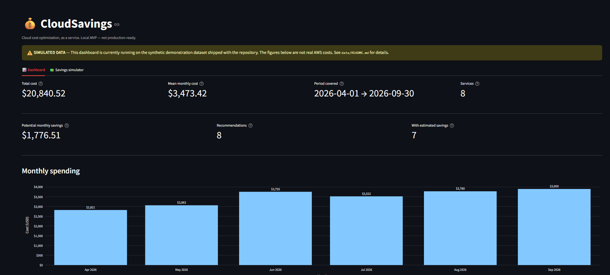

# CloudSavings

**Cloud cost optimization as a service — Result-as-a-Service (RaaS) model.**

CloudSavings is a local-first web application that helps companies
identify potential AWS cost savings, measure the results of approved
optimizations, and simulate a percentage-of-savings fee model.

> **Status: early MVP.** This is not a production service. It runs
> entirely on your machine, uses synthetic demonstration data by
> default, never connects to AWS, and never modifies any cloud
> resource.



## What it does

- **Cost dashboard** — total spend, monthly trends, breakdown by AWS
  service, month-over-month changes.
- **CSV import** — load your own AWS Cost Explorer export (or use the
  bundled sample). Strict validation, no silent acceptance of bad data.
- **Recommendations** — five transparent rules surface cost anomalies,
  step changes, concentration, daily outliers, and storage review
  candidates. Every recommendation lists the evidence required before
  acting and the risks involved.
- **Savings measurement** — distinguishes four very different things
  that most tools conflate:
    - **Potential** savings (estimates from the rules)
    - **Observed** savings (a real cost drop, not necessarily caused
      by us)
    - **Verified** savings (attributable to an approved intervention,
      capped at the customer's declared expectation)
    - **Eligible for billing** (the subset of verified that matches
      the contract)
- **RaaS fee simulator** — an *illustrative* percentage-of-savings
  calculation. No payment, no invoice.
- **Reports** — a downloadable Markdown document and a flat CSV
  summary.

## What it deliberately does **not** do

- It does **not** connect to your AWS account. All input is a CSV file
  you export yourself.
- It does **not** modify any cloud resource. No write access, no
  automatic actions.
- It does **not** claim that any resource is unused or wasted based on
  cost data alone. Recommendations are signals, not findings.
- It does **not** conflate estimated savings with verified savings.
- It does **not** generate invoices, process payments, or handle
  taxes.

## Quickstart

### Requirements

- Windows, macOS, or Linux
- Python 3.12 (3.11 works too; 3.13+ untested)
- Git

### 5 commands

```powershell
git clone https://github.com/alacherif10/cloudsavings.git
cd cloudsavings
py -3.12 -m venv .venv
.\.venv\Scripts\Activate.ps1     # Windows PowerShell
python -m pip install -r requirements.txt
streamlit run app.py